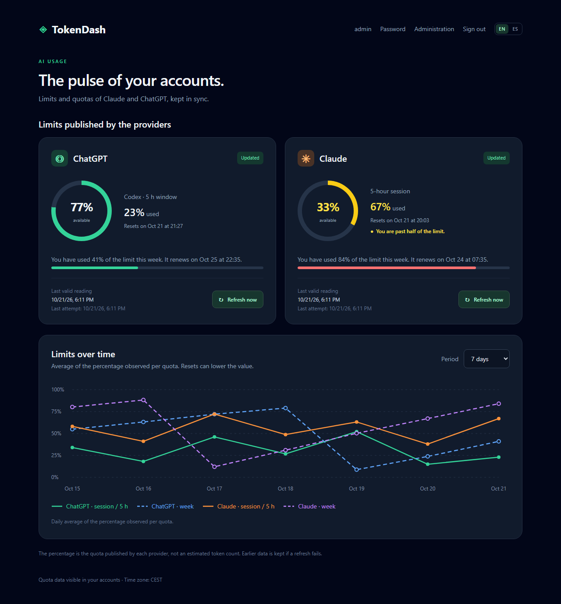

# TokenDash

**English** · [Español](README.es.md)

**See at a glance how much is left of your ChatGPT and Claude limits.**



<sub>Screenshot with sample data.</sub>

ChatGPT (Codex) and Claude limit how much you can use them: one limit renews every 5 hours and another one every week. TokenDash reads them on its own, every 20 minutes or as often as you choose, and shows them on a web page with a chart of how they change. You install it once on a computer at home that is always on (a mini PC, a Raspberry Pi, a NAS, a server) and open it from your phone or your computer.

- **No PC or browser needs to stay open.** The server reads the limits by itself.
- **Clear at a glance.** Each card turns yellow when you pass half of a limit and red past 80 %.
- **You choose how often it refreshes.** In **Administration → Settings**: from every 15 minutes to every 6 hours.
- **Only pay for one subscription?** Choose "Only ChatGPT" or "Only Claude" in **Settings** and the dashboard shows just that card, full width ([see how it looks](docs/img/panel-single-account.png)).
- **Only real data.** It shows the percentages OpenAI and Anthropic publish, with no estimates. Without a reading it says "No data", never 0 %.
- **English and Spanish.** Everyone sees it in their browser's language and can switch with the **EN · ES** buttons. Every page has its own address under `/en/` and `/es/`.
- **Your data stays at home.** Everything runs on your computer; there is no external TokenDash service.
- **Home Assistant.** You can put the ChatGPT card, the Claude card or the chart on your Home Assistant dashboard, each on its own, or use the percentages as sensors.

> TokenDash is a personal, unofficial project under the [MIT licence](LICENSE). It is not affiliated with OpenAI or Anthropic. It uses the same interfaces as their official clients (Codex and Claude Code), which may change without notice; if a reading fails, the dashboard keeps the last good one with its date.

## What you need

| | |
|---|---|
| A computer that is always on | Linux (Ubuntu, Debian, 64-bit Raspberry Pi OS…) or Windows 10/11. x86-64 or ARM64 processor (Raspberry Pi 4 or 5). 1 GB of free RAM and 3 GB of disk are plenty. |
| Docker | The program that runs TokenDash. The installation guide explains how to install it. |
| Your accounts | A ChatGPT subscription that includes Codex (Plus, Pro…) and/or a Claude subscription (Pro or Max). One of the two is enough. |

## Quick installation

If you already have Docker and Git, on Linux it takes four commands. Replace `192.168.1.50` with your computer's IP address (`hostname -I` shows it):

```bash
git clone https://github.com/cmorato-dev/TokenDash.git ~/tokendash
```

```bash
cd ~/tokendash
```

```bash
python3 scripts/init_env.py 192.168.1.50
```

```bash
docker compose up -d --build
```

The first time takes a few minutes. Then open **http://192.168.1.50:8000** from any device on your network.

**First time with Docker, or on Windows?** Follow the [step-by-step installation guide](docs/INSTALL.md).

## First sign-in

Sign in with:

- **Username:** `admin`
- **Password:** `tokendash`

TokenDash asks you to choose a new password before you can go on: the initial one is public, because it is on this page. Afterwards, in **Administration → Users**, you can change the username, create other users or change the password again. [The usage guide](docs/USAGE.md) explains it.

## Connect your accounts

On the dashboard, open **Connect accounts**:

1. **ChatGPT:** done from the browser itself, in a couple of minutes. [How to connect ChatGPT](docs/USAGE.md#connect-chatgpt).
2. **Claude:** done once from the server's console, by copying and pasting four commands the dashboard gives you. [How to link Claude](docs/LINK_CLAUDE.md).

As soon as they are connected, the cards switch to "Updated" and the chart starts to fill up.

If you only use one of the two, choose it first in **Administration → Settings → Accounts you use**: the other one disappears from the dashboard and from "Connect accounts", and the server does not read it.

## How often it refreshes

By default, TokenDash reads the limits every 20 minutes. To change it, open **Administration → Settings**, choose another frequency (from 15 minutes to 6 hours) and press **Save**. The change applies from the next minute, without restarting anything. The same page shows when the last automatic reading was and when the next one is due.

The **Refresh now** button on each card also reads them right away.

## Guides

| Guide | What for |
|---|---|
| [Step-by-step installation](docs/INSTALL.md) | Install Docker and TokenDash on Linux, Raspberry Pi or Windows |
| [Using the dashboard](docs/USAGE.md) | First sign-in, language, users and passwords, connecting ChatGPT, refresh frequency, reading the cards and the chart |
| [Link Claude](docs/LINK_CLAUDE.md) | Connect your Claude account, command by command |
| [Home Assistant](docs/HOME_ASSISTANT.md) | Cards and sensors on your Home Assistant dashboard |
| [Maintenance](docs/MAINTENANCE.md) | Update to a new version, backups, moving to another computer, HTTPS |
| [Troubleshooting](docs/TROUBLESHOOTING.md) | What to do if something does not work |
| [How it works inside](docs/ARCHITECTURE.md) and [development](docs/DEVELOPMENT.md) | For anyone who wants to understand or change the code |

## Security and privacy

- TokenDash is meant for your **home network**. Do not open it to the Internet by forwarding ports on your router; to reach it from outside, use a VPN (Tailscale, WireGuard…) or a proxy with HTTPS ([Maintenance → HTTPS](docs/MAINTENANCE.md#https)).
- The ChatGPT connection is stored **encrypted** in the database. The Claude session is kept by the official Claude Code client in private storage of the container, and TokenDash never reads it.
- TokenDash **sends no messages** to ChatGPT or Claude: it only asks for the limits, so it does not use up your quota.
- The `.env` file holds the keys of your installation. Do not share it or upload it anywhere.
